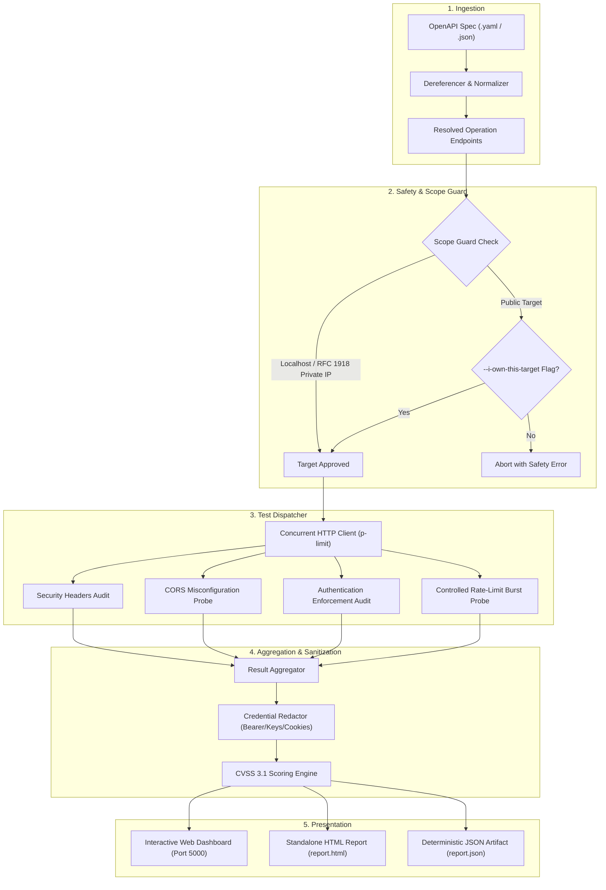

# api-sec-scanner 🛡️
### Automated API Security Scanner, DAST Engine & Interactive Dashboard

[](https://github.com/chaiitanya-r/api-sec-scanner/actions/workflows/ci.yml)
[](https://nodejs.org)
[](https://www.docker.com/)
[](https://nodejs.org/api/esm.html)
[](LICENSE)

`api-sec-scanner` is a production-ready, automated Dynamic Application Security Testing (DAST) engine and interactive reporting dashboard built with modern JavaScript (ESM, Node.js 20+). It parses OpenAPI 3.x specifications to systematically audit REST APIs against foundational security controls and OWASP API Security Top 10 baselines.

Whether you are a developer verifying endpoints before merging code, a security engineer conducting compliance audits, or a DevOps team enforcing security quality gates in CI/CD pipelines, `api-sec-scanner` provides immediate visibility into your API attack surface with actionable remediation snippets.

> 🔒 **Strictly Defensive & Non-Destructive**: This tool contains **no exploit payloads, injection attacks, fuzzing wordlists, or brute-force routines**. All test probes remain controlled, bounded, and benign. It is engineered specifically for safe testing in local, staging, and production environments without causing downtime or data corruption.

---

## 📑 Table of Contents

- [What is api-sec-scanner?](#-what-is-api-sec-scanner)
- [How It Works (Under the Hood)](#-how-it-works-under-the-hood)
- [Defensive Security Checks](#-defensive-security-checks)
- [How Results Are Presented](#-how-results-are-presented)
- [Quickstart Guide](#-quickstart-guide)
  - [Option 1: Docker (Fastest Setup)](#option-1-docker-fastest-setup)
  - [Option 2: Local Node.js / npm](#option-2-local-nodejs--npm)
- [Interactive Web Dashboard Guide](#-interactive-web-dashboard-guide)
- [CLI Reference & Usage](#-cli-reference--usage)
- [CI/CD Pipeline Integration (Quality Gates)](#-cicd-pipeline-integration-quality-gates)
- [Included Vulnerable Testbed API](#-included-vulnerable-testbed-api)
- [Safety Scope Guard & Responsible Disclosure](#-safety-scope-guard--responsible-disclosure)
- [Project Scripts](#-project-scripts)
- [Production Deployment](#-production-deployment)
- [License](#-license)

---

## 🎯 What is api-sec-scanner?

Traditional application scanners are often invasive, slow, and generate extensive noise or destructive payloads. `api-sec-scanner` was engineered with a modern, contract-first philosophy:

1. **Contract-Driven Auditing**: Uses your existing OpenAPI 3.x contract (`.yaml` or `.json`) as the single source of truth to discover endpoints, path parameters, and expected authorization schemes.
2. **Deterministic Baseline Testing**: Evaluates core security requirements—Security Headers, CORS policies, Authentication barriers, and Rate Limiting defenses.
3. **Multi-Format Visual Reporting**: Automatically presents results in three formats: an interactive modern React dashboard, a self-contained offline HTML report, and a structured machine-readable JSON file.
4. **DevOps & CI/CD Native**: Features a `--fail-on <severity>` security gate that automatically fails CI builds if vulnerabilities at or above your risk tolerance are detected.
5. **Zero False Positives on Hardened Endpoints**: Verified against hardened control endpoints implementing modern defense-in-depth standards.

---

## ⚙️ How It Works (Under the Hood)

The scanning workflow proceeds in six sequential phases:



### Detailed Pipeline Stages

1. **Contract Parsing**: The OpenAPI specification is fully dereferenced (resolving `$ref` pointers), parameters are normalized, and harmless sample path parameters are inserted (e.g., replacing `{userId}` with `1`).
2. **Scope Guard**: Target URLs are evaluated against strict network safety boundaries. By default, only `localhost`, `127.0.0.1`, and RFC 1918 private IPv4 subnets are allowed. Public internet hostnames require the `--i-own-this-target` flag.
3. **Controlled Probing**: The HTTP dispatcher dispatches benign, non-destructive requests throttled by `p-limit` concurrency pools to avoid overwhelming the server.
4. **Data Redaction**: All captured request and response evidence is filtered through sensitive data masks to sanitize Authorization headers, session cookies, passwords, and API keys.
5. **Report Generation**: Results are scored using CVSS 3.1 metrics, mapped to specific remediation advice, and output into JSON, HTML, and Web Dashboard views.

---

## 🛡️ Defensive Security Checks

`api-sec-scanner` audits APIs against four foundational security pillars:

| Check Category | What It Evaluates | Why It Matters | Default Severity |
|---|---|---|---|
| **Security Headers** (`headers`) | Inspects responses for `Content-Security-Policy`, `Strict-Transport-Security`, `X-Content-Type-Options`, and `X-Frame-Options`. Flags technology disclosure (`X-Powered-By`, verbose `Server`). | Protects clients from MIME-sniffing, clickjacking, and protocol downgrade attacks, while preventing technology fingerprinting. | **LOW** to **MEDIUM** |
| **CORS Misconfiguration** (`cors`) | Probes CORS behavior using benign origin reflection tests (`audit-probe.example.com`). Flags wildcard origins (`*`) and arbitrary reflection with credentials enabled (`Access-Control-Allow-Credentials: true`). | Prevents malicious third-party websites from reading sensitive API data on behalf of authenticated users. | **MEDIUM** to **HIGH** |
| **Authentication Enforcement** (`auth`) | Audits endpoints marked in the OpenAPI spec as requiring security schemes (Bearer tokens, API keys, OAuth). Dispatches: 1) request without credentials, 2) request with malformed token, 3) request with expired token. | Identifies broken authentication where backend routes accidentally bypass auth middleware despite specification intent. | **HIGH** |
| **Rate Limiting Baseline** (`rate`) | Executes a controlled, bounded request burst (default $N=30$, maximum 100 requests) to test whether the server enforces throttling (`429 Too Many Requests` + `Retry-After`). | Defends endpoints against denial-of-service (DoS), resource exhaustion, and automated credential stuffing. | **MEDIUM** |

---

## 📊 How Results Are Presented

`api-sec-scanner` offers three distinct, complementary ways to consume audit findings:

### 1. Interactive React Web Dashboard (Port 5000)

The Web Dashboard is an enterprise-grade, dark-mode first UI designed for interactive analysis:

* **Executive Summary Cards**: Instant visibility into `CRITICAL`, `HIGH`, `MEDIUM`, `LOW`, and `INFO` finding totals with single-click filtering.
* **Real-Time Search & Verb Filters**: Search across endpoints, vulnerability titles, and IDs. Filter by HTTP verbs (`GET`, `POST`, `PUT`, `DELETE`, etc.).
* **Finding Detail Drawer**: Click any vulnerability to open a slide-out drawer featuring:
  * Vulnerability overview and severity badge.
  * Exact CVSS score rating.
  * Full redacted request headers and response evidence.
  * **Remediation Guide** with copyable fix code snippets (Express, Helmet, CORS middleware, etc.).
* **Live "Audit Target" Dialog**: Run new security audits directly from the browser by specifying a target URL and OpenAPI contract.
* **One-Click Exporting**: Download structured `report.json` or trigger a formatted executive print/PDF report.

### 2. Standalone HTML Report (`report.html`)

A completely self-contained, offline-compatible HTML file generated with `--html report.html`:
* Zero external CSS or JavaScript dependencies—opens directly in any web browser without needing a server.
* Professional executive summary section suitable for compliance and management reviews.
* Expandable finding cards with color-coded severity pills and technical evidence.

### 3. Structured JSON Report (`report.json`)

A standardized machine-readable JSON document produced with `--out report.json`:
* Deterministic layout with scanner version, scan duration, target URL, and timestamp.
* Summarized count matrix for easy programmatic consumption.
* Full array of finding objects with IDs, CVSS scores, remediation notes, and sanitized HTTP evidence.

---

## ⚡ Quickstart Guide

### Option 1: Docker (Fastest Setup)

Run the entire ecosystem (Web Dashboard + Vulnerable Testbed API) with a single command:

```bash
docker compose up
```

Once running:
* **Interactive Dashboard**: Open [http://localhost:5000](http://localhost:5000)
* **Vulnerable Testbed API**: Running at [http://localhost:3000](http://localhost:3000)
* **Run automated audit in Docker**:
  ```bash
  docker compose run --rm audit
  ```

---

### Option 2: Local Node.js / npm

**Prerequisites**: Node.js `20.x` or higher and npm `10.x` or higher.

```bash
# 1. Clone the repository
git clone https://github.com/chaiitanya-r/api-sec-scanner.git
cd api-sec-scanner

# 2. Install dependencies & build frontend bundle
npm install
npm run build

# 3. Launch the Web Dashboard
npm run dashboard
# Open http://localhost:5000 in your browser
```

---

## 🖥️ Interactive Web Dashboard Guide

The web interface lets you run audits and inspect results without typing CLI commands:

```bash
npm run dashboard
```

1. Navigate to `http://localhost:5000`.
2. **View Sample Audit**: By default, the dashboard displays findings from an audit of the sample API so you can explore all features immediately.
3. **Audit Your Own Target**:
   - Click the **"Audit Target"** button in the top navbar.
   - Enter your Target Base URL (e.g. `http://127.0.0.1:3000`).
   - Enter your OpenAPI specification path (e.g. `./testbed/openapi.yaml`).
   - Select the defensive checks you want to run (Headers, CORS, Auth, Rate Limiting).
   - Adjust the safe probe burst limit (between 5 and 100).
   - Click **"Execute Audit"**.
4. **Explore Findings**:
   - Click on any severity card (`Critical`, `High`, `Medium`, etc.) to filter the table.
   - Use the search bar to find specific endpoints (e.g. `/api/private-profile`).
   - Click any row to view the full request/response evidence and copy remediation snippets.
5. **Export Results**:
   - Click the **Download** icon to save `report.json`.
   - Click the **Printer** icon to generate a print/PDF summary.

---

## ⌨️ CLI Reference & Usage

Run the scanner directly from the terminal for one-off checks or scripting:

```bash
node src/index.js \
  --spec ./testbed/openapi.yaml \
  --base-url http://127.0.0.1:3000 \
  --out report.json \
  --html report.html \
  --checks headers,cors,auth,rate \
  --burst 30
```

### Complete Options Table

| Option | Flag Alias | Description | Default |
|---|---|---|---|
| `--spec <path>` | `-s` | Path to OpenAPI 3.x specification (`.yaml` or `.json`) | *Required for scan* |
| `--base-url <url>` | `-u` | Base URL of the target API | *Required for scan* |
| `--out <path>` | `-o` | Output file path for JSON report | `report.json` |
| `--html <path>` | | Output file path for standalone HTML report | None |
| `--checks <list>` | `-c` | Comma-delimited checks: `headers,cors,auth,rate` | `headers,cors,auth,rate` |
| `--burst <num>` | `-b` | Number of probe requests for rate limit check (max 100) | `30` |
| `--timeout <ms>` | `-t` | HTTP request timeout in milliseconds | `5000` |
| `--concurrency <n>` | `-k` | Maximum concurrent HTTP connections (`p-limit`) | `5` |
| `--i-own-this-target` | | Explicit authorization flag for public internet hostnames | `false` |
| `--fail-on <severity>` | | CI gate: fail with exit code 2 if findings $\ge$ severity (`critical`, `high`, `medium`, `low`) | None |
| `--serve [port]` | | Launch the interactive web dashboard & API server | `5000` |
| `--help` | `-h` | Display help screen and command options | |

---

## 🚀 CI/CD Pipeline Integration (Quality Gates)

`api-sec-scanner` is designed for frictionless inclusion in modern CI/CD pipelines. Using the `--fail-on` flag transforms the scanner into an automated security gate that stops vulnerable code from reaching production.

### GitHub Actions Workflow Example

Create `.github/workflows/api-security-audit.yml`:

```yaml
name: API Security Gate

on:
  pull_request:
    branches: [ main ]

jobs:
  security-audit:
    runs-on: ubuntu-latest
    steps:
      - name: Checkout code
        uses: actions/checkout@v4

      - name: Setup Node.js
        uses: actions/setup-node@v4
        with:
          node-version: 20
          cache: 'npm'

      - name: Install dependencies
        run: npm ci

      - name: Start Application API Server
        run: |
          npm run testbed &
          npx wait-on http://127.0.0.1:3000

      - name: Run DAST Security Audit (Fail on HIGH or CRITICAL)
        run: |
          node src/index.js \
            --spec ./testbed/openapi.yaml \
            --base-url http://127.0.0.1:3000 \
            --out report.json \
            --html report.html \
            --fail-on high

      - name: Upload Security Reports
        if: always()
        uses: actions/upload-artifact@v4
        with:
          name: api-sec-reports
          path: |
            report.json
            report.html
```

### CLI Exit Codes

| Exit Code | Status | Meaning |
|:---:|---|---|
| `0` | **Success** | Scan completed successfully and no findings violated `--fail-on`. |
| `1` | **Error** | Execution error, invalid arguments, unresolvable OpenAPI spec, or scope guard denial. |
| `2` | **Gate Failed** | Security threshold breached: one or more findings met or exceeded `--fail-on`. |

---

## 🧪 Included Vulnerable Testbed API

The repository comes with a built-in mock Express API (`testbed/server.js`) specifically engineered to demonstrate how vulnerabilities and hardened defenses appear in scan reports:

```bash
npm run testbed
# Starts on http://127.0.0.1:3000
```

### Testbed Route Inventory

| Endpoint | Method | Security Condition | Expected Scanner Result |
|---|---|---|---|
| `/api/private-profile` | `GET` | Missing authentication middleware; leaks `X-Powered-By: Express/4.21.0-Vulnerable`. | Flagged as **HIGH** (Authentication missing) & **LOW** (Header leakage). |
| `/api/public-data` | `GET` | Permissive CORS configuration (`Access-Control-Allow-Origin: *`). | Flagged as **MEDIUM** (Wildcard CORS). |
| `/api/action-burst` | `POST` | Sensitive state-changing endpoint without rate limiting. | Flagged as **MEDIUM** (Missing rate limiting). |
| `/api/secure-control` | `GET` | **Hardened Control Endpoint**: Enforces strict Bearer auth, token validation, 5 req/10s rate limits with `Retry-After: 60`, strict origin validation, and full security headers (`CSP`, `HSTS`, `XFO`, `nosniff`). | **ZERO FALSE POSITIVES**: Passes all checks cleanly. |

---

## 🛡️ Safety Scope Guard & Responsible Disclosure

Safety and responsible execution are built into the scanner core:

1. **IP Scope Protection**: Out of the box, `api-sec-scanner` only scans:
   - `localhost` / `127.0.0.1`
   - RFC 1918 Private Subnets (`10.0.0.0/8`, `172.16.0.0/12`, `192.168.0.0/16`)
2. **Explicit Authorization**: Public internet hostnames and external IP addresses are actively rejected unless the user explicitly passes `--i-own-this-target`.
3. **Bounded Burst Thresholds**: Rate limit probes cannot exceed 100 requests under any circumstances.
4. **Credential Redaction**: Authorization tokens (`Bearer ***`, `Basic ***`), API keys, and session cookies are sanitized before saving reports.

---

## 📦 Project Scripts

The project includes convenient npm scripts for all common workflows:

| Script | Command | Description |
|---|---|---|
| `npm run dashboard` | `node src/server.js` | Starts the production dashboard & API server on port `5000` |
| `npm run build` | `npm --prefix client run build` | Builds the React frontend production bundle into `client/dist/` |
| `npm test` | `vitest run` | Executes all 43+ unit and integration test suites |
| `npm run test:all` | `vitest run && npm --prefix client run build` | Runs backend tests and verifies client compilation |
| `npm run lint` | `eslint .` | Runs ESLint across all JavaScript files |
| `npm run testbed` | `node testbed/server.js` | Launches the vulnerable testbed API on port `3000` |
| `npm run clean` | `node src/utils/clean.js` | Removes temporary scan reports while preserving directory structure |
| `npm run client:dev` | `npm --prefix client run dev` | Starts Vite hot-reloading dev server for frontend development |

---

## 🌐 Production Deployment

### 1. Standalone Docker Deployment
```bash
# Build the production image
docker build -t api-sec-scanner:latest .

# Run the container (Dashboard on port 5000)
docker run -d -p 5000:5000 --name api-sec-scanner api-sec-scanner:latest
```

### 2. Linux Systemd / PM2 Service
```bash
npm ci --omit=dev
npm run build
pm2 start src/server.js --name "api-sec-scanner"
```

### 3. Static Client Hosting (Vercel / Netlify / Cloudflare Pages)
The React dashboard can be deployed as an independent static Single Page Application:
```bash
cd client
npm ci
npm run build
# Deploy client/dist/ to your preferred static hosting platform
```

---

## 📄 License

Distributed under the **MIT License**. Free for personal, commercial, and enterprise use. Designed with care for application security engineers, developers, and DevOps teams.
